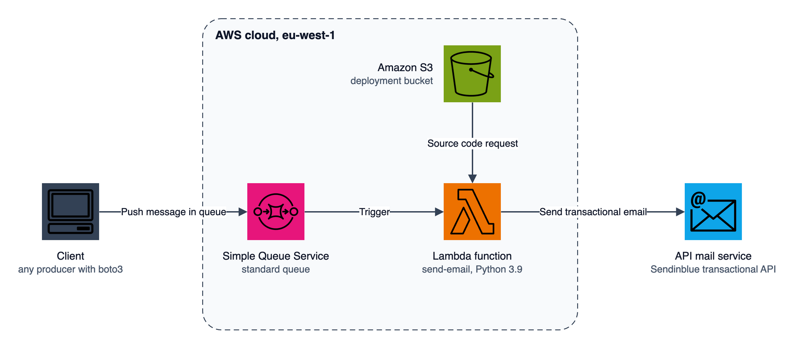

<p align="center">
  
</p>

<h1 align="center">Serverless-AWS-transactional-mailer</h1>

<p align="center">
  <strong>Drop a message in a queue, a Lambda sends the email.</strong><br>
  An SQS-triggered Python function that calls the Sendinblue transactional API, deployed with
  the Serverless Framework from your shell or from a Docker container.
</p>

<p align="center">
  <a href="#quick-start">Quick start</a> &middot;
  <a href="#how-it-works">How it works</a> &middot;
  <a href="#message-format">Message format</a> &middot;
  <a href="#tech-stack">Tech stack</a> &middot;
  <a href="#documentation">Documentation</a>
</p>

<p align="center">
  
  
  
  
  
</p>

<p align="center">
  
  <br>
  <sub>A client pushes a message in the queue, the queue triggers the function, the function
  calls the mail API. The deployment package lives in S3.</sub>
</p>

---

An application should not wait for a mail provider to answer before it responds to its user,
and it should not lose the email when the provider is slow. Putting a queue between the two
solves both: the application pushes a small JSON message and moves on, and a function drains the
queue at its own pace.

**Serverless-AWS-transactional-mailer** was written in 2022 as a DevOps demonstration of that
pattern on AWS. A standard SQS queue triggers a Python 3.9 Lambda; the function reads a template
id, a recipient and template parameters from the message and calls the
[Sendinblue](https://www.brevo.com) (now Brevo) transactional email API with `sib-api-v3-sdk`.
Everything account-specific (queue URL and ARN, deployment bucket, API keys) is read from SSM
Parameter Store at deploy time, so the repository holds no secret. The same code was reused as
the mailer of the author's e-commerce school project. It is kept as a reference and is not
actively maintained.

## Quick start

**Prerequisites:** an AWS account with the [AWS CLI configured](https://docs.aws.amazon.com/cli/latest/userguide/cli-chap-configure.html)
on `eu-west-1`, an SQS queue, an S3 bucket for the deployment packages, a Sendinblue account
with a transactional template, Node.js with `npm`, and Python 3 with `pip`.

```sh
git clone https://github.com/verovec/Serverless-AWS-transactional-mailer.git && cd Serverless-AWS-transactional-mailer
aws ssm put-parameter --name S3_BUCKET --value <bucket> --type SecureString              # deployment bucket
aws ssm put-parameter --name QUEUE_URL --value <https://sqs...> --type SecureString       # the queue the function drains
aws ssm put-parameter --name QUEUE_ARN --value <arn:aws:sqs:...> --type SecureString     # the same queue, as a trigger
aws ssm put-parameter --name SENDINBLUE_API_KEY --value <key> --type SecureString        # v3 API key of your account
aws ssm put-parameter --name API_KEY_SERVERLESS --value <any-secret> --type SecureString # API Gateway key declared by serverless.yml
npm install -g serverless && sls plugin install -n serverless-python-requirements
sls deploy --verbose --conceal
QUEUE_URL=<https://sqs...> python3 test/test_mailer.py                                  # pushes an empty test message
```

The function is named `send-email` and runs every time messages land in the queue; follow it
with `sls logs -f send_email --tail`. To deploy without installing anything locally, build the
image from the `Dockerfile` and run it with your AWS credentials: see
[`docs/deployment.md`](docs/deployment.md).

## How it works

1. A client, any code with AWS credentials and `boto3` or the SDK of its language, calls
   `sqs.send_message` with a JSON body.
2. The SQS event source polls the queue and invokes `send-email` with a batch of up to 10
   messages, waiting at most 60 seconds to fill it.
3. `lambda_handler` reads the first record, deletes it from the queue, builds a
   `SendSmtpEmail` (recipient, template id, parameters) and calls
   `TransactionalEmailsApi.send_transac_email`. An `ApiException` is raised and lands in the
   CloudWatch logs.
4. Sendinblue renders the template with the parameters and delivers the email.

Two limits of the example are worth knowing: only the first record of each batch is processed,
and the message is deleted before the API call, so a failed send is logged rather than retried.
[`docs/architecture.md`](docs/architecture.md) covers the stack and its settings.

## Message format

| Field | Type | Role |
|-------|------|------|
| `template_id` | integer | Id of the transactional template in your Sendinblue account |
| `user` | object | The recipient as Sendinblue expects it: `{"email": "...", "name": "..."}` |
| `params` | object | Values substituted in the template, for example `{"firstname": "Ada"}` |

`test/test_mailer.py` sends `{"template_id": 0, "user": {}, "params": {}}` to the queue named by
`QUEUE_URL`, enough to see the function run and fail on the API side.

## Tech stack

| Layer | Tech | Location |
|-------|------|----------|
| Function | Python 3.9, `boto3` 1.21.21, `sib-api-v3-sdk` 7.4.0 | `src/send_email_sendinblue/send_email_sendinblue.py`, `requirements.txt` |
| Trigger | SQS event source, batch of 10, 60 s batching window, 900 s timeout | `serverless.yml` |
| Infrastructure | Serverless Framework, CloudFormation, SSM Parameter Store, S3 deployment bucket | `serverless.yml` |
| Deploy container | `node:17-alpine3.14` with Python 3, runs `sls deploy` | `Dockerfile`, `.env-example` |
| Test | `boto3` producer that pushes a message in the queue | `test/test_mailer.py` |

Details in [Architecture](docs/architecture.md).

## Documentation

| Topic | Where |
|-------|-------|
| Files, data flow, what the stack creates, configuration | [`docs/architecture.md`](docs/architecture.md) |
| SSM parameters, deploy from the CLI or from Docker, test, cleanup | [`docs/deployment.md`](docs/deployment.md) |
| Recipes, swapping the mail provider | [`docs/development.md`](docs/development.md) |
| Everything else | [`docs/`](docs/README.md) |

## Contributing

The repository is a finished demonstration and is kept as is. Issues are still welcome, for
example when the Lambda runtime or the Sendinblue SDK pinned here is retired. If you do not want
Sendinblue, adapt the function and `requirements.txt` as described in
[`docs/development.md`](docs/development.md).
